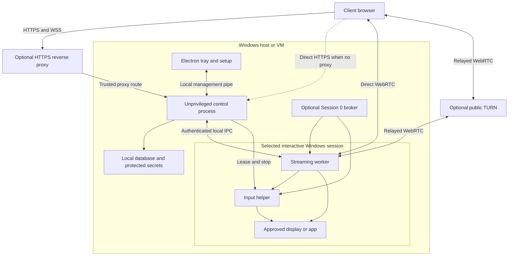
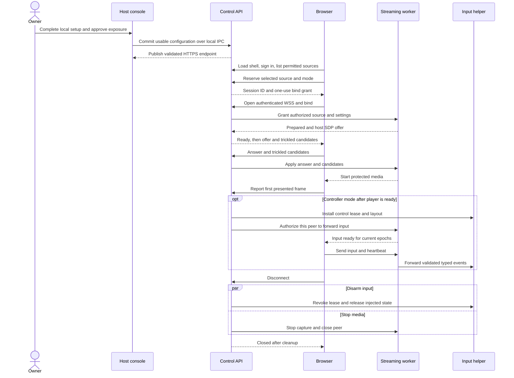

# End-to-end system design

## Scope and ownership

Ship a browser frontend and a Windows backend in one signed installer. The first release serves one authorized stream from one interactive Windows user session. It supports Windows 11 x64 and a certified desktop Chromium client first. Mobile touch, other browsers, advanced encoders, gamepads, Windows Server and a managed access gateway each require their own validation. App selection is not a multi-tenant security boundary; use a separate restricted guest for untrusted users.

| Boundary | Authority | What crosses |
|---|---|---|
| Browser ↔ control process | Control authorizes accounts, sources, sessions and configuration | Static files, HTTPS API, authenticated WSS |
| Console ↔ control process | Local signed-in owner initiates setup and local stop | Restricted named-pipe operations; no browser credentials |
| Control ↔ streaming worker | Control authorizes capture; worker validates live source and grant | Metadata, SDP, candidates, readiness and revocation |
| Control ↔ input helper | Control owns exclusive lease; helper verifies and injects | Lease, policy, layout generation and stop |
| Worker ↔ input helper | Worker forwards input only for established controller peer | Bounded typed events; no OS handles or shell commands |
| Browser ↔ worker | WebRTC transport establishes protected peer path | Video and audio toward browser; input only for controller |
| Peers ↔ relay | TURN allocates and relays within quotas | Encrypted peer transport, never account/admin traffic |

Electron's trusted renderer is a management interface. The native media process owns the Windows capture, encoder and the sending peer in the gaming path. The browser is always a normal web client. The disposable Electron media prototype must use the same observable session contract before comparing performance.

## Deployment

LAN uses trusted HTTPS with direct ICE when possible. Internet deployments independently validate frontend reachability, signaling relay through any reverse proxy, and direct or relayed media. Behind CGNAT, use a reachable VPN or separately designed access gateway for HTTPS; TURN remains solely for WebRTC. Do not install privileged broker or open internet-facing firewall rules in the standard per-user mode.

## Main success path

Local setup validates the account, TLS bindings, configured source policy and interactive worker before publishing readiness. Loading the URL only serves a shell. Source enumeration is authenticated and filtered. Reserving a stream neither begins capture nor grants input. The host offers SDP only after WSS binding, source verification and worker preparation. The controller lease is reserved atomically at session creation; actual injection is enabled only after the current media generation and input helper are ready. A viewer never receives control authority.

## Failure and recovery

The control process is the authoritative session actor. The browser maps snapshots to UI; it never declares a lease current. A worker or helper cannot extend its own lease. Authorization is checked at reservation, bind, capture start, source change, reconnect and renewal. Device or network errors cannot turn a restricted source into full desktop capture.

| Failure | Immediate action | Recovery |
|---|---|---|
| Wrong TLS identity or origin | Refuse request/upgrade | Owner repairs certificate or canonical URL |
| Auth or policy revoked | Revoke input and media independently of the socket | Require fresh authorization |
| WSS breaks, media still alive | Freeze new control on detected loss; stop renewing input authorization | Rebind with fresh grant and state snapshot; existing media expires unless renewed |
| ICE loses path | Disarm input; show recovery state | Fresh ICE generation, one restart then bounded new peer |
| Media stalls, transport connected | Gate input; compare capture/encode and decode/presentation progress | Recreate same approved pipeline or close with reason |
| Source geometry changes | Suspend coordinate input immediately; increment layout epoch | Updated frame/layout and explicit layout acknowledgment |
| Window gone or desktop switches | Stop capture/input; never pick replacement display | New selection after policy recheck |
| GPU/worker exits | Independent input release and stream cleanup | Restart worker within crash budget; new session or authorized reconnect |
| Host restarts | Do not restore live peers, leases or grants | Re-enroll healthy processes; user starts again |

Keep teardown idempotent. Revoke first, then close the transports and resource owners in parallel. Keep reservations blocked until the former owner is known stopped or its process is fenced and reaped. A failed or unconfirmed teardown is host-unavailable, not permission to issue a competing controller lease.

## Delivery gates

1. Prototype identical 1080p60 workloads on Electron and the native worker. Record encode provider, frames presented, path, and physical input-to-photon latency.
2. Prove a LAN round trip on one signed-in Windows user with HTTPS, view-only, controller, local stop and scripted lease failures.
3. Certify one GPU/driver/browser profile, process-scoped audio, and installer/update recovery before broadening support.
4. Add TURN and externally tested TLS/network topologies. Relay failover and metrics must show actual selected route.
5. Release only supported combinations after the [acceptance matrix](10-operations-and-acceptance.md) passes. Architecture inputs and performance budgets are test hypotheses, not guarantees.
