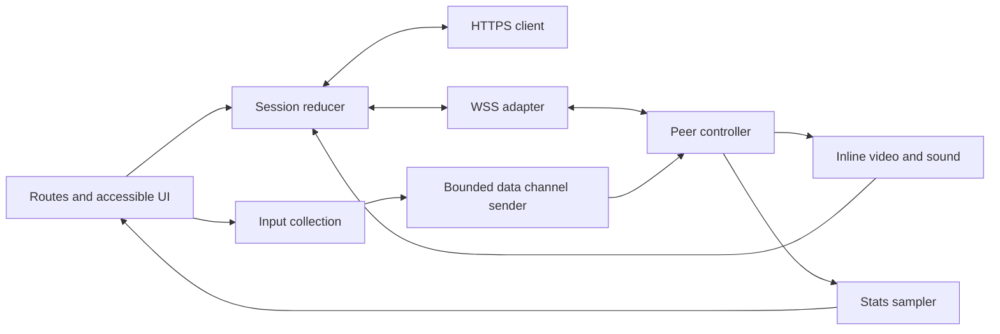
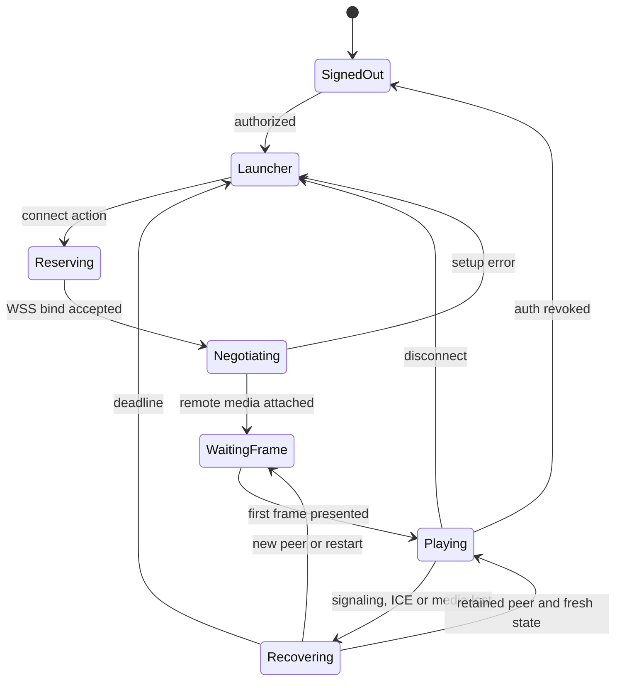

# Browser frontend design

## High-level structure

Serve a same-origin static SPA from the Windows control API, with no Electron API, service worker or third-party runtime dependency in the browser. Browser storage may remember theme and preferred preset, never passwords, ICE credentials or signaling grants. A server-supplied capability set governs options; a capability probe is never authorization.

| Route | Reads and actions |
|---|---|
| `/` | Anonymous shell and login; after login fetch `me`, capabilities, and source catalog. Offer one allowed source automatically only as a preselection. |
| `/play` | Active session state held in memory; show connecting/recovering/error, player, source/preset control and disconnect. Refresh requires authorization and resume; never restore a peer from cached data. |
| `/admin` | Role-gated settings, diagnostics and config version. Server repeats authorization for each operation. |
| Unauthorized/unsupported | No source thumbnails before authorization. Display HTTPS, browser or host troubleshooting with safe error text. |

## State and network behavior

Implement a reducer with `auth`, `catalog`, `intent`, `serverSnapshot`, `peer`, `layout`, `input` and `error` slices. Each connection attempt has a local monotonically increasing generation and an AbortController. Drop completions from prior generations even when the server session ID is unchanged. Close the prior socket, peer, media attachment and timers before mounting a replacement. Only update UI after server acknowledgment; settings responses are applied/pending/rejected, not optimistic authority.

On Connect, keep the user-selected capture mode and requested preset, send reservation with idempotency key, open WSS, bind with the grant and obtain ICE config. Create one peer per connection epoch. Install the host's offer, serialize candidate queuing/drain, create and set the answer, then send it. Set received stream as the video element's `srcObject`. No browser capture permission is required. Register peer callbacks before applying remote description. Ignore ICE, track and data channel callbacks from disposed epochs. Do not run a second negotiation queue for settings.

Use `playsinline` and inspect `play()` failures. Retry sound/fullscreen/pointer lock on explicit gestures. Report `media.ready` after a presented frame (video frame callback where supported, otherwise a capability-qualified playback/frame observation). Do not wait for a deliberately muted track to play before reporting a presented video frame. Warn separately when negotiated audio is absent or browser playback is blocked. A connected ICE state alone cannot show Playing. On a source or peer transition, hide old video until fresh frames from the new generation are confirmed.

## Input, layout and user experience

- Controller requires Playing, foreground focus, current layout acknowledgment, current lease and host `input.ready`. View-only never emits input channels. Losing focus, pointer lock or control stops heartbeats and sends best-effort release.
- Convert element clicks to normalized video-content coordinates using rendered content rect, not the full element. Ignore bars and overlay interactions. Acknowledge new layout only after the current frame dimensions and geometry agree. Never reuse coordinates across epochs.
- Relative pointer mode sends cumulative displacement from a reset baseline. Use physical key codes for games; text entry is a separately negotiated capability. Touch maps gestures to pointer actions first; do not claim native touch injection or gamepad support without host capability.
- Apply backpressure before serialization. Relative snapshots may be replaced; reliable edge overflow disarms control and requests fresh input state. Stop listeners before resetting state. Show the local escape action continuously and support keyboard navigation.
- Sample WebRTC stats once per second while active. Compare only matching stats IDs and advancing timestamps. Show actual decode/presentation FPS, resolution, bitrate, RTT, route and loss; missing values display as unavailable. RTT is not input-to-photon latency. Do not emit raw candidate addresses or input in telemetry.

## Failure and validation

WSS rebind obtains a new single-use grant. Restore from the authoritative snapshot; do not replay old SDP, input or layout acknowledgments. Retained peers wait for fresh authorization and input rearm. Network loss, mobile backgrounding, suspended timers or unsupported controls lead to a visible recovery or view-only state. On exit, abort in-flight HTTP and detach video even if the server cannot be reached; host leases expire independently.

Test stale promises after reconnect, duplicated Connect, blocked sound, mobile orientation and hidden tab, candidate-before-offer, ICE failure, refresh and tab takeover, view-only no input, release on blur and unavailable metrics. Hardware certification must include real browsers and the selected render/decoder path. The [shared contracts](09-contracts.md) and [input helper design](06-input-helper.md) define the wire boundary.
