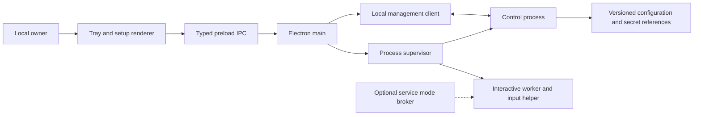
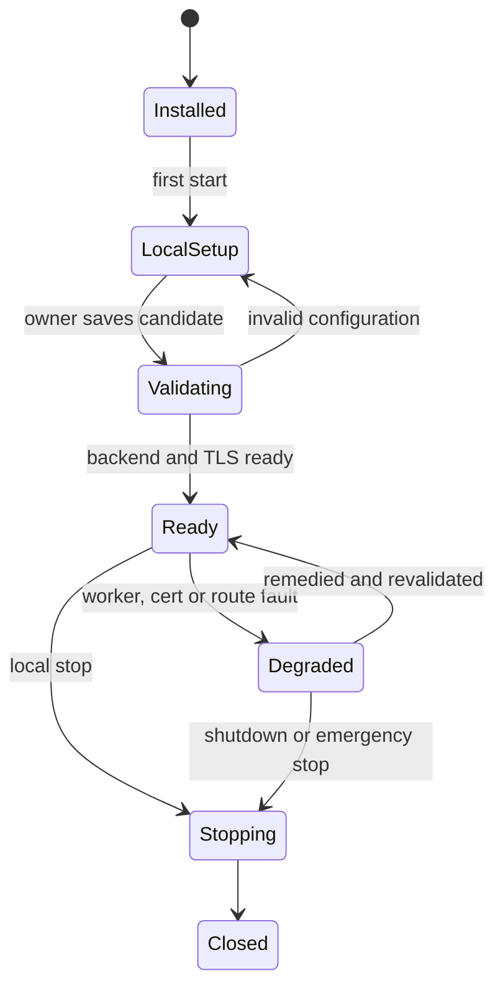

# Electron host console design

## Process layout

Electron is the locally trusted setup and management application. Its main process supervises the unprivileged control backend in per-user mode. The backend owns durable writes and session orchestration. The renderer uses packaged assets and a minimal context-isolated preload bridge. Production capture is implemented by the streaming worker, not the renderer.

Do not use the per-user supervisor and Windows service as concurrent owners of the same child. In service mode the console is a management client; the backend process still runs unprivileged. Neither renderer opens a public IPC port. Navigation, popups and webviews are disabled; bundled local content is the only privileged origin. Validate sender frame and operation at the main-process boundary.

## Install, enroll and publish

1. Installer verifies platform and installs signed files without granting Windows administrator privileges to the runtime. On first app launch, acquire a single-instance lock and inspect GPU, display, audio, Windows session, disk and network.
2. Enter setup through local owner IPC. Offer expiring one-use enrollment capability scoped to the selected local owner and host instance. Keep public HTTPS disabled until a password is set, a policy exists and trusted TLS validates.
3. Local wizard selects reachability profile, exact bind and allowed origins, certificate and renewal mode, permitted sources, whether audio/input is enabled, and optional TURN. Never suggest TLS bypass or default public exposure.
4. Backend stages settings, validates certificate/key matching, endpoint names, route and worker eligibility, and commits via expected configuration version. Activation failure reverts to last known good configuration, or stays local-only on first install. Bind failure must not be presented as Ready.
5. Show URL, certificate expiry, active profile, selected user session and separate results for HTTPS, WSS and media. Map untested reachability to Unknown. Make QR strictly URL-only.
6. Local stop is visible in tray and UI. Closing the setup window returns to tray; Quit and Stop Sharing require distinct labels and semantics.

## Management contract

| Operation | Input | Output and effects |
|---|---|---|
| `setup.status` | None | Host capability snapshot, redacted findings, current config revision |
| `setup.enroll` | Ephemeral bootstrap proof and owner credentials | Owner enrollment; commit once; secret fields excluded from logs |
| `config.validate` | Candidate settings, expected revision | Field issues and effective bindings; no live state change |
| `config.apply` | Candidate, expected revision, explicit exposure approval | Staged activation and durable revision or rollback result |
| `sharing.stop` | Active session ID or all | Disarm and revoke; wait for authoritative stopped/unavailable snapshot |
| `diagnostics.generate` | Selected categories | Redacted summary; explicit export from UI |
| `update.prepare` | Approved release channel | Signed artifact verification and staged installation status |

Preload exposes these calls as named functions with typed parameters, never generic IPC, Node APIs or renderer-supplied paths. Underlying management pipe authorizes Windows user and instance, not a renderer claim. The backend derives and stores the owner password hash; clear the original password from UI state and never persist it in Chromium storage. Keep certificate keys and TURN secrets in Windows-protected storage; configuration references them by ID.

## Supervision and local stop

Use child readiness notifications, not process existence, for Ready. Backoff restarts after unexpected exits and maintain a rolling crash budget. On backend death, independently disarm input via expiry; disable the public listener and show degraded state until re-enrollment. If a Stop Sharing command cannot reach control, the per-user supervisor stops the media worker using its owned process handle; in service mode the broker supplies the equivalent bounded stop path. Prevent respawn until owner re-enables sharing. Report Stop complete only after helper disarm and media stopped or process termination verified. Run under normal user privileges.

Test installer repair, corrupted settings, occupied port, invalid certificate, duplicate launch, quit during stream, inaccessible backend, local stop with dead control API, service/per-user mutual exclusion, and no public listener before enrollment. See [operations](10-operations-and-acceptance.md).
