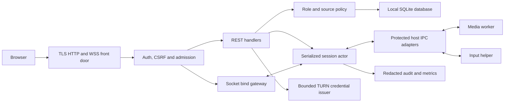
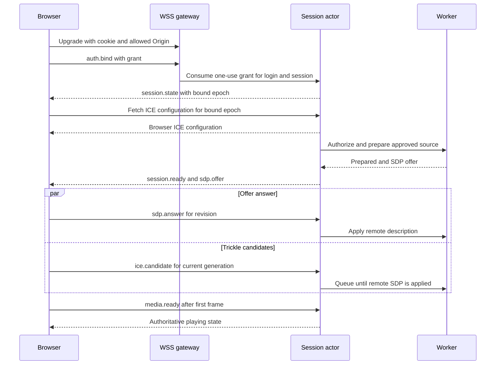

# Control API and signaling design

## Internal structure

Run TypeScript control services in a supervised unprivileged process. Serve static assets with strict content security policy, no third-party runtime code and no wildcard CORS. Use a maintained HTTP framework with explicit request and server limits; verify Host and Origin against canonical origin, and honor forwarded fields only from configured proxies. Use local SQLite with migrations and restricted ACLs. Secrets are protected separately. Do not bind a native IPC endpoint to an HTTP route.

## Identity, policy and data model

| Record | Persistence | Fields and invariants |
|---|---|---|
| User | Durable | ID, normalized login, Argon2id hash, role grants, enabled, auth revision. Rate-limit authenticator work independently of sockets. |
| Auth session | Durable or memory | Token digest, user ID, issue/idle/absolute expiry, auth revision, optional MFA freshness. Rotate on login and privilege change. |
| Host config and source policy | Durable | Version, mode, allowed app/display identities, audio/input grants, trusted origins, certificate and TURN secret references. |
| Session reservation | Live registry | Owner/auth session, source generation, requested vs effective settings, peer and layout epochs, state, deadlines. Do not restore on restart. |
| Control reservation | Live registry | Unique host slot, owning session/epoch; an armed lease exists only after media and helper readiness. |
| Bind grant | Live, keyed by digest | Session, auth session, purpose, expiry, consumed marker; atomically consume once. |
| Audit | Durable and bounded | Time, event ID, actor ID, outcome, reason code and safe context. Do not log raw SDP, passwords, input or relay creds. |

Register all state mutations through a single session actor mailbox and reserve host capacity through an atomic registry operation; never await a worker inside the registry lock. Asynchronous completions carry epoch plus operation ID and are ignored when no longer expected. Opaque catalog IDs translate to server-owned native source identities. No browser window handles, PIDs, command strings or filesystem paths are accepted for capture or dispatch.

## REST contract

All routes below use `/api/v1`. Require Secure, HttpOnly, same-origin cookie sessions and CSRF for mutations, including logout, ICE credential issuance and socket grant generation. Owner local enrollment is IPC only. Authentication failure is `401`; authorization `403` or `404` when needed to hide existence; stale state or resource conflict `409`; overload `429` or `503`. Responses for protected data use no-store. Use the [shared error envelope](09-contracts.md).

| Route | Request → response |
|---|---|
| `POST /auth/login` | Credentials and optional MFA assertion → fresh cookie session plus account summary; handle staged MFA explicitly |
| `POST /auth/logout` | CSRF proof → `204` and all streams owned by this login revoked |
| `GET /me`, `GET /capabilities` | Account/host policy → permitted roles, modes, codecs and limits |
| `GET /sources` | Auth context → catalog generation plus opaque allowed items |
| `POST /sessions` | `{sourceId,catalogGeneration,mode,preset}` with user-scoped idempotency key → `201 {session,bindGrant}`; stable reservation on equivalent retries |
| `GET /sessions/{id}` | Owner/admin → authoritative snapshot and effective settings |
| `POST /sessions/{id}/signaling-grant` | Owner of active session → fresh one-use bind or resume grant |
| `POST /sessions/{id}/ice-config` | Owner with valid session and matching epoch/generation → short-lived ICE servers; issue with bounds |
| `PATCH /sessions/{id}/settings` | Versioned requested changes → applied/pending/rejected plus actual settings; switch requires owner and source policy |
| `DELETE /sessions/{id}` | Owner/admin → `202` when stopping or `204` once terminal; safe repeated calls |
| `GET /admin/diagnostics`, `POST /admin/diagnostics/export` | Admin → redacted state or time-limited export; never export raw capture, input or secrets |
| `PUT /admin/config` | Recent admin-auth and expected version → staged activation or validation/rollback error |

Scope idempotency to the same authenticated login and canonical request. Conflicting reuse returns `409`; retries of a consumed or expired bind grant must obtain a fresh grant, not replay it. Use cryptographic randomness for secrets and constant-time comparison of digests.

The host slot transitions `empty → reserved → occupied → draining → empty`; no second requester can pass admission during draining. Only a verified stop or confirmed exit of the fenced owner clears draining. An abandoned reservation with no child startup can expire directly. The session actor tags every async command with `(sessionId, connectionEpoch, operationId)`, starts timers before dispatch, and handles cancellation even if the worker still owes a reply. Audit a terminal transition once, outside cleanup routines that can retry.

## Signaling lifecycle and concurrency

Bind `/api/v1/signal` within five seconds. Begin with no capture or expensive parsing work beyond the bounded bind envelope. Publish the bound epoch before preparing the peer. The browser's ICE config lookup and worker startup can run concurrently; the browser may receive an offer before its lookup completes and must queue it within the setup deadline. Do not wait for `session.ready` to permit the ICE lookup. Correlate each offer, answer, candidate and layout event with the current session revision. Sequence the SDP/candidate consumers; buffer only current and explicitly expected generations, with caps. Host is sole offerer. Reject malformed, unsolicited, stale, out-of-direction and cross-session messages. WSS rebind consumes a fresh grant, atomically replaces socket authority, invalidates old input readiness, and returns a complete state snapshot. It may retain a healthy peer, start ICE again, or replace the peer. Never replay SDP, ICE or input from a prior connection.

Stop marks the session Closing before accepting further work; revoke helper and worker using independent IPC, stop renewals, and close WSS. Closing must not rely on the now-revoked browser to cooperate. Resource slots only reopen after teardown or supervised termination; a timeout marks the host unavailable. Durable account/source policy changes invalidate active leases immediately and advance policy revision.

Test single-slot races, duplicate create with lost response, duplicate grant consumption, cross-origin WSS, controller denial, mismatched session/epoch, caps before heavy parsing, two tabs rebind, stop during async startup, revocation with WSS cut, database migration and restart with stale client. Definitions and provisional timers are in [shared contracts](09-contracts.md).
