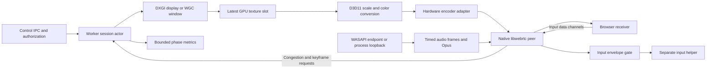
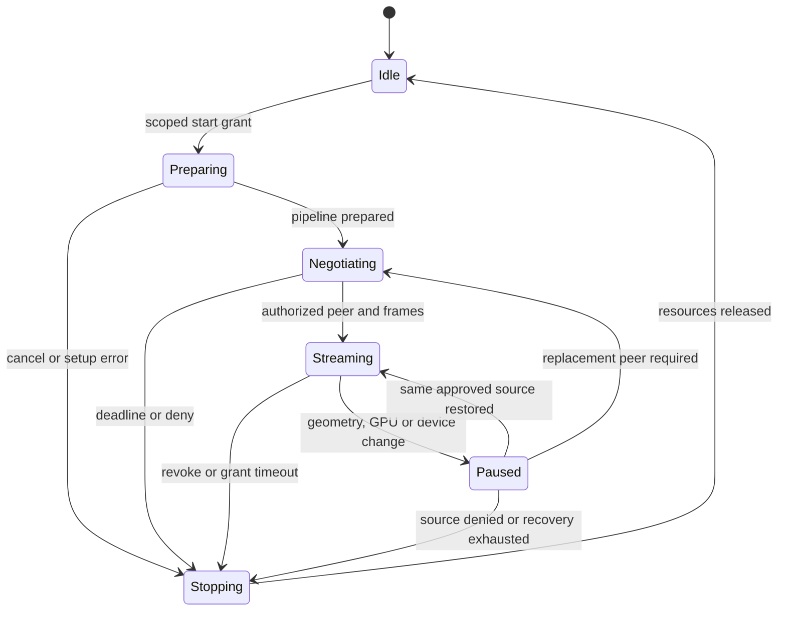

# Native streaming worker design

## Pipeline and ownership

The unprivileged C++ worker runs in the selected interactive Windows user session. A supervised worker instance may become ready without capturing any frame. Start capture only when a current control grant binds the user session, process instance, source identity, media policy and connection epoch. The worker owns the sending WebRTC peer and never accepts inbound application management traffic over the network.

| Module | Contract and ownership |
|---|---|
| Source catalog | Enumerate display paths and window/process metadata; resolve opaque approved source to current native identity. Compare process creation identity, handle ownership, user session and active desktop immediately before opening. |
| Capture adapters | DXGI for certified whole-display profiles; WGC for certified app window profiles. Return reference-counted GPU frames with time, visible rect, rotation and generation. A failed window capture cannot fall back to desktop. |
| Texture processing | Keep D3D11 textures on one adapter when supported; explicitly report cross-adapter copy/fallback. Scale and convert to negotiated SDR color range and input pixel format without blocking capture on encoder. |
| Encoder providers | One hardware provider first; negotiate H.264 profile/level or certified VP8 fallback, with bitrate, keyframe and pipeline reconfigure hooks. Hardware usage must be measured and reported. |
| Audio | WASAPI endpoint loopback for authorized desktop audio; process-tree loopback for permitted app audio. If isolation fails, offer silence/unavailable, never system mix. |
| WebRTC sender | Use libwebrtc for RTP, RTCP, encryption, ICE, pacing and congestion; implement provider adapter rather than tunneling an encoded file into a browser track. |
| Input gate | Declared channels only; validate message bounds, current controller peer, expected epochs and helper connection. Helper repeats authority checks. |

## Threads and backpressure

A serialized worker actor owns commands and the current pipeline pointer. Capture, encoder and audio callbacks publish scoped completions; never mutate lifecycle state on an arbitrary provider callback. Dedicated network/signaling threads follow libwebrtc threading requirements. GPU-device access is owned by a designated processing thread or explicitly synchronized device context. Stop awaits drain with a deadline; completions for an expired grant or prior generation free buffers and do not publish.

Video uses one replaceable pending capture frame plus bounded in-flight GPU/encoder slots. Drop superseded frames before encode, not arbitrary interdependent encoded packets after the encoder. Timestamp capture on a monotonic host time base; convert to media timestamps without cross-clock arithmetic. Audio uses a bounded sample ring; handle underruns/overruns with measured discontinuity/silence, not accumulating unlimited lag. Make queued frames retain/return texture references exactly once. Reserve measured memory and encoder capacity before reporting Prepared.

### Prepared → streaming

1. Validate source and grant expiry; construct capture provider, adapter and encoder capabilities. Select the intersection with browser and approved settings.
2. Create sending transceivers (video, optional audio) and planned data channels before host offer; serialize SDP and candidates by revision. For receiver support use [shared negotiation rules](09-contracts.md).
3. Start transmitting only on an authorized peer. Keep source identity and protected-desktop checks live. Retain permission to emit frames/data only while the worker grant remains valid.
4. Forward actual encoder, selected path, frames captured/encoded and timing counters. Track incoming keyframe requests with coalescing; use negotiated congestion feedback to adjust target bitrate quickly and outer preset changes with hysteresis.
5. A geometry change halts coordinate injection, clears stale frames and bumps layout epoch. A compatible source switch can reuse transceiver but must independently reauthorize and only resume after the new source delivers a frame. If codec/profile needs change, queue one controlled renegotiation.

## Degraded modes and validation

If the capture device resets, freeze input, stop emitting stale video, destroy dependent textures and encoder references, rebuild on the same approved source, and return an epoch-tagged outcome to control. Process exit, lock, secure desktop or revoked grant stop media and input; a disconnected user session cannot be treated as an eligible desktop without a tested configuration. Resize, monitor hotplug, audio switch, masked windows and HW-to-SW encoding fallback must report actual effective settings. User/admin approval is required for an explicit tier downgrade when advertised gaming requirements cannot hold.

Test stale provider callbacks after stop, D3D11 loss and cross-adapter copies, frame ownership under pressure, window PID reuse, native encoder/codec interop, partial setup cleanup, voice-free app audio isolation, keyframe rate limit, sustained motion and recovery after relay transition. Use real GPU/driver/browser combinations and the [physical latency method](10-operations-and-acceptance.md).
