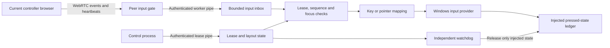
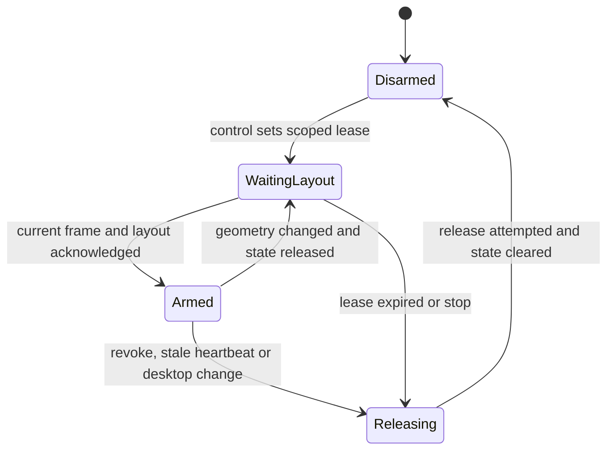

# Input helper design

## Trust and state

Run a small, isolated standard-user helper alongside the media worker in the same Windows session. It receives lease control from the authenticated control process and bounded input from the authenticated worker over distinct logical IPC channels. The worker cannot create, transfer or renew a lease. The helper checks active Windows desktop, effective input policy and exact epochs before each injection batch. It never runs as a workaround for UIPI, sends secure attention sequences, accepts raw shell commands or bypasses game input restrictions.

Use one event loop for authorization, layout changes and injection. Prioritize revoke and release over event batches; impose bounded processing work per tick. Keep `armedLease`, `lastFreshHeartbeat`, `layout`, `lastCriticalSeq`, `lastMotionSeq`, `relativeBaseline` and injected keys/buttons inside the helper. Authorization TTL and liveness use local monotonic time. If controlling authorization or worker heartbeat fails, cancel pending input and release only successfully tracked injected controls. Helper or whole-machine failure cannot guarantee execution of release itself; session supervision must not claim it did.

## Event format and routing

| Field | Rule |
|---|---|
| `v,kind` | Version and typed event discriminator. No generic calls into the OS provider. |
| `sessionId,connectionEpoch,layoutEpoch,controlEpoch` | Must exactly match an armed lease and installed layout. Peer, geometry or ownership transition changes at least one epoch. |
| `seq` | Independent nonnegative safe integer sequence on each channel; reject duplicates and stale snapshots. Reset only under newly acknowledged arm epoch. |
| `payload` | Strict per-kind fields and sizes; no map of arbitrary keycodes, native handles or scripts. |

Starting caps, to validate on certified devices: 2 KiB message size, 240 motion snapshots/s, 120 critical messages/s, 64 queued critical entries. If reliable backpressure would lose a release or keyboard edge, disarm, flush, release injected state and require new readiness. Critical messages use an ordered reliable channel; motion is unordered with zero retransmissions and replaces older snapshots. State snapshots on the critical channel reconcile missed releases. Heartbeat at 250 ms carries advancing sequence; timeout after 1 second without accepted heartbeat. A backlog of old messages cannot rearm or keep a stopped lease alive; on buffer age cap or a new epoch require fresh readiness and sequence baseline. See [shared contracts](09-contracts.md).

| Kind | Payload and handler |
|---|---|
| `key.edge` | Allowed physical key identifier plus down/up; use an explicit scan-code translation table. Handle AltGr, modifiers and repeats separately. |
| `pointer.button`, `pointer.wheel` | Allowlisted button and direction; bounded wheel deltas; suppress if motion mode or geometry invalid. |
| `pointer.absolute` | Finite normalized coordinates in the video content, within [0,1]; apply current crop/rotation/virtual desktop transform. |
| `pointer.relative` | Sequenced cumulative signed displacement, bounded delta from last accepted baseline; disarm/resync on discontinuity beyond cap. |
| `state.snapshot` | Bounded list of currently pressed states; reconcile already-injected ledger, never invent state from malformed data. |
| `heartbeat`, `release.all` | Fresh liveness tick or immediate disarm. Release does not grant authority. |
| `text.commit`, `gamepad.state` | Future capability-gated types; reject in v1 if not negotiated and certified. |

For absolute motion the browser first converts video pixels from the element after fit/letterboxing. The helper maps normalized input through the worker's authoritative rotation/crop into native physical desktop coordinates, then uses the virtual desktop origin and dimension of the active layout for provider conversion. Clamp the last valid pixel; do not cross into unrelated coordinates under restricted window policy. Reject when foreground owner, expected Windows session, capture bounds or secure desktop conditions are no longer valid. Window focus checks provide a guard, not isolation; use the [system security boundary](01-system.md) for untrusted users.

On partial provider failure record only definitely accepted edges; if the batch result is ambiguous, fail closed, attempt a bounded release of potentially injected edges, and require rearm. Do not release unrelated physical keys indiscriminately. Surface protected input as a capability/error, never retry with elevated privileges.

Test exact lease identity on forwarded messages, watchdog under WSS/worker/API death, reliable overflow, stuck modifiers, stale layout/replay, partial platform writes, mixed-DPI negative origins, relative packet loss and reconciliation, rapid window focus changes, local keyboard interaction and unsupported elevated applications.
