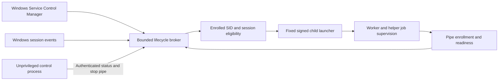
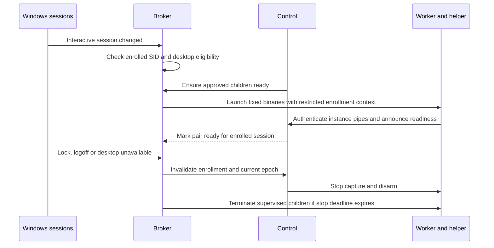

# Windows session broker design

## Scope and privileges

The optional Windows service supervises streaming worker and input helper instances in one explicitly enrolled interactive session. Standard per-user installs run without a service and use the Electron supervisor. Service mode is explicit, installed through the signed installer, and must not make remote sign-in, desktop unlock or arbitrary-user process launch available. Session 0 cannot capture or inject into an interactive desktop.

Keep privileged service code limited to enrollment lookup, session selection, fixed process launch, status and emergency stop. Use the minimum service identity and privileges demonstrated by the prototype for approved session launches; enable any needed privilege only for the checked operation. The HTTP stack, Electron renderer, encoders and general policy engine stay outside this service. Service configuration and child executable directories must not be writable by a normal user. Do not accept program paths, arbitrary arguments, raw Windows access tokens or a remote-requested SID from control.

## Lifecycle

Enumerate sessions on startup and reconcile on session events rather than trusting the last user event. Apply an explicit SID/session selector; if multiple sessions match and no enrolled selection exists, require local resolution. Treat lock, disconnect and secure desktop as unavailable by default. Session change retires authorization first and old children second. Never attach a new worker/helper to the former session's lease.

A child entry has `windowsSessionId`, `ownerSid`, `bootInstanceId`, `childInstanceId`, role, verified executable, process/job handles, startup deadline, state and crash history. Reuse neither a PID nor a pipe name as identity. Verify both binary and token/session at launch, use a constrained environment, and pass one-time enrollment through a local protected channel. Use supervised process objects and inspect exit notifications; do not find and kill processes by name. Ensure late launch completion cannot make a retired session Ready. Only mark Ready once both the required worker and helper have authenticated; a view-only profile can proceed without an input helper when policy permits.

| Command | Scope |
|---|---|
| `status` | Return enrolled session availability and owned child instance states; redact secrets and unrelated session details. |
| `ensureReady` | Idempotently ensure the locally configured eligible pair is ready. Configuration version must match enrolled settings. |
| `stopOwned` | Target the authorized current owned pair, disarm first, stop within deadline, fence and reap if needed. |
| `shutdown` | Local service-control path; reject arbitrary browser dispatch. |

Enforce ACLs, verify local peer identity and deny remote pipes. Use a strict command allowlist and deadlines. Limit rapid restarts and show a stable unavailable status after budget is exhausted. Service recovery restarts only eligible infrastructure; it cannot resume previous streams. On upgrade drain first and activate only the matching signed backend versions.

Test boot without login, user switch with running stream, lock during preparation, late process exit and PID reuse, repeated failed launches, mismatched token/ACL, privilege stripping, logoff during stop and rollback with no stranded children. Keep per-user mode as the default if unattended service lifecycle is not yet certified.
