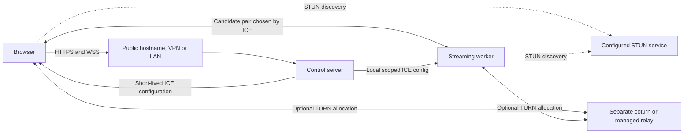
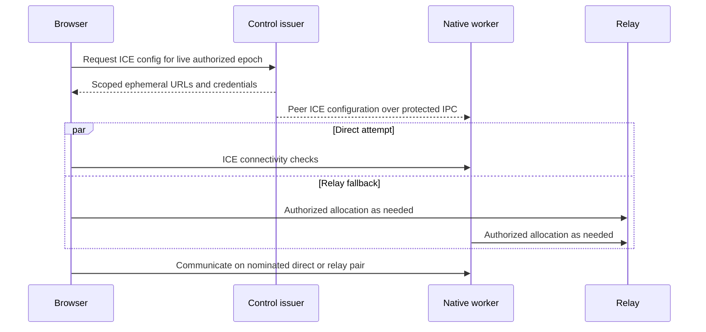

# STUN, TURN and network design

## Three independent paths

HTTPS reaches the browser assets and REST API; WSS carries authenticated signaling through the same origin; WebRTC uses ICE to select a direct or relayed media and input path. HTTPS success does not prove ICE success. TURN is not an HTTPS reverse proxy, an authentication authority or a workaround for an unreachable host URL.

| Profile | Web endpoint | Media policy |
|---|---|---|
| LAN | Locally trusted certificate and hostname, restricted listener | Same-network direct connectivity; no external STUN required |
| VPN | VPN hostname and TLS | Direct on VPN if measured, optional relay |
| Public reachable host | Trusted hostname, reverse proxy or validated listener | Direct UDP when possible, TURN for difficult NAT/firewall |
| CGNAT or blocked inbound HTTPS | Separately provided VPN/access gateway | Direct when viable; TURN UDP or TURN TLS/TCP |
| Restricted client egress | Verify HTTPS/WSS separately | TURN TLS on 5349 or dedicated 443 listener; report if still blocked |

Use the [installation port matrix](../02-installation-and-networking.md). Never assume opening 443 enables UDP media; only advertise a bounded direct UDP range after verifying the pinned native allocator and bindings. TURN needs its configured listener and relayed transport range on the relay node; these are distinct from Windows media ports. Certificate, DNS, proxy timeout/upgrade, cloud security group, Windows firewall and relay reachability are separate checks.

## Credential and relay design

Configure coturn or a managed relay separately from the host installer. Configure relay/public addresses and NAT mappings, scoped peer-address policy, transport listeners and TLS renewal, operating limits and redacted logs. Relay keys stay on the provisioning system and control backend; both peers receive only short-lived derived credentials. Use a different opaque per-session peer scope for browser and worker. Do not log secrets, ICE credentials, candidate addresses or raw SDP.

Use the provider's supported mechanism; for coturn's shared-secret mode, issue a username with expiry plus an opaque scoped suffix, and compute the documented base64 HMAC-SHA1 credential with the selected secret. This is compatibility with the configured TURN authentication scheme, not a password storage design. Issue credentials to an authenticated session and current epoch only; rate-limit requests and apply the configured TTL (initially ten minutes). Browser gets the ICE config from the control API after binding; worker receives it through authenticated IPC. Allow authorized refresh before restart/long session needs; test allocation refresh across credential expiry rather than assuming browser behavior. Use dual accepted secrets for a staged rotation where supported; stop new issuance if clock skew or secret configuration makes expiry unreliable. Revoking a session closes the endpoints and does not depend on TURN TTL.

Set ICE transport policy to allow all approved paths normally; use relay-only diagnostics to verify selected relay paths and policy-restricted deployments. Trickle without full gathering waits. A failed selected route triggers bounded recovery with fresh generation and credentials; do not allow unauthenticated fallback or claim TCP-relay gaming performance identical to UDP. Label selected pair based on both candidate types, transport and relay protocol where available. Gathering relay candidates alone is not proof of media.

## Validation and operations

Prove external HTTPS cert validation, signed-in WSS and actual video/audio/input in forced relay from two networks. Test UDP-blocked and TLS-only clients, no relay available, quotas, clock skew, expired credentials, dual-secret rotation, existing allocations, proxy expiry, NAT hairpin and Wi-Fi-to-cell transfer. Track allocations, quota/denial rates, relay byte rate, throughput degradation and region/route health. Set per-user/allocation/aggregate limits; capacity plans use bitrate plus overhead and both relay legs. At 20 Mbps, one media direction is roughly 9 GB/hour before overhead; billing depends on charged directions. Before admitting sessions, verify that the reserved allocation count and expected peak rate fit the configured capacity with headroom; tell operators which limit failed.
