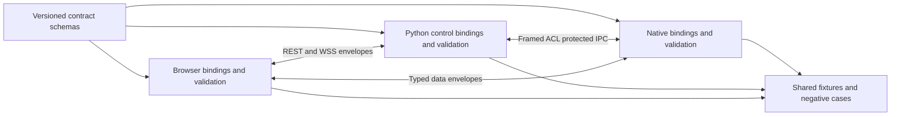

# Shared contracts, time and versioning

This document defines the interfaces between [browser](02-browser.md), [control](04-control-and-signaling.md), [worker](05-streaming-worker.md) and [input](06-input-helper.md). Values are engineering defaults for the first interoperability spike. Put public schemas and native frames in a versioned shared package. Generate bindings and validate at each receiving boundary; TypeScript types alone do not validate JSON.

## Identity and epochs

| Field | Owner and rule |
|---|---|
| `hostInstanceId`, `childInstanceId` | Fresh random IDs per process boot or launch; receipts from retired instances are ignored. |
| `sessionId` | Opaque random reservation ID tied to authenticated login; an ID conveys no authority. |
| `catalogGeneration`, `sourceId` | Catalog revision and opaque reference; unavailable outside policy; resolved live by worker before capture. |
| `connectionEpoch` | Server increments when allocating a new peer. WSS binding revision also changes on socket replacement even if peer stays. |
| `negotiationRevision` | Monotonic within peer epoch; only host creates an offer for the next revision. |
| `iceGeneration` | Monotonic within peer epoch; increments for restart; associate with negotiated ICE ufrag and relevant mids. |
| `layoutEpoch` | Increments on source/geometry change; pointer packets with old epoch are invalid. |
| `controlEpoch` | Increments on disarm/re-arm or lease transfer, even across socket replacement with retained peer. |
| `configVersion`, `policyRevision` | Durable compare-and-swap versions. Authorization revocation invalidates work scoped to the retired policy. |

Use bounded opaque strings and nonnegative safe integers. Crossing an epoch boundary resets that scope's queues and sequence baselines. Do not compare monotonic clocks across processes; issue durations and install local deadlines on authenticated receipt. Protocol-issued wall-clock credentials and TLS use synchronized wall clocks with bounded skew.



## Public wire examples

`POST /api/v1/sessions` request and response are illustrative v1 payloads:

```json
{
  "sourceId": "src_opaque",
  "catalogGeneration": 12,
  "preset": "balanced",
  "mode": "controller"
}
```

```json
{
  "session": {
    "id": "sid_opaque",
    "state": "reserved",
    "connectionEpoch": 0,
    "negotiationRevision": 0,
    "iceGeneration": 0,
    "layoutEpoch": 0,
    "controlEpoch": 0,
    "effectiveSettings": null
  },
  "bindGrant": { "token": "one_use_opaque", "expiresInMs": 15000 }
}
```

Generic error: `{ "code": "SOURCE_STALE", "requestId": "req_opaque", "retryable": true, "message": "Refresh the available sources." }`. Stable codes include `HOST_UNAVAILABLE`, `GPU_UNAVAILABLE`, `SOURCE_DENIED`, `SOURCE_STALE`, `CONTROLLER_BUSY`, `GRANT_EXPIRED`, `VERSION_MISMATCH`, `LAYOUT_STALE`, `ICE_FAILED`, `FIRST_FRAME_TIMEOUT` and `RATE_LIMITED`. Classify user denial and incompatibility separately from transient failures. Browser strings localize codes; safe message is a fallback, never raw exception traces.

WSS envelopes after bind: `{v,type,sessionId,connectionEpoch,negotiationRevision,messageId,payload}`. Initial `auth.bind` uses only version, type, session ID, message ID and short-lived proof until authority is established. The server never trusts a caller-supplied destination peer. Sender/direction and routing derive from authenticated socket and current actor state.

| Message | Direction and payload |
|---|---|
| `auth.bind` | Browser → control: one-use proof, optionally last seen epoch to detect resume. |
| `session.ready`, `session.state` | Control → browser: authoritative snapshot, assigned scopes, effective settings, readiness or closing reason. |
| `sdp.offer` → `sdp.answer` | Host → browser then browser → host: bounded SDP string and expected revision, mediated by control. |
| `ice.candidate`, `ice.complete` | Both via control: generation, expected ufrag when available, candidate with mid/index or end-of-candidates. |
| `media.ready` | Browser → control: receipt for current connection/revision/layout; advisory only. |
| `layout.changed` → `layout.ack` | Control → browser then browser → control: authoritative geometry and acknowledgment of layout epoch. |
| `input.ready` | Worker → browser on the reliable data channel after helper arm acknowledgment: session ID, connection/control/layout epochs and allowed input modes. A new control epoch requires a fresh ready receipt and reset input sequences. |
| `settings.request` → `settings.result` | Optional WSS adapter to the same REST policy/handler, with expected revision. No parallel negotiation. |
| `resume.request` → `resume.result` | Retained-peer recovery after rebind; report authoritative keep/restart/replace and epoch. |
| `session.stop`, `session.error`, `ping`, `pong` | Stop request/notification, safe structured error, liveness. No control authority implied. |

No browser-generated offers. Each endpoint serially installs the expected remote description then drains queued candidates, checking generation and ufrag when known. Cap at 128 KiB per WSS envelope and 200 queued candidates per revision, expire early queues after five seconds, and cap cumulative live queues per session. Do not queue unsolicited future revisions without a matching expected offer/restart. Reject stale ICE even if its session ID is valid. No replay of signaling after reconnect.

## Local IPC framing and verbs

Use local-only Windows named pipes with explicit ACLs and OS-verified peer identity; bind to enrolled process instance and role before accepting commands. Browser cannot access the pipes. Proposed frame: four-byte little-endian length of UTF-8 JSON payload, then payload; bound before allocating. Zero-length, invalid UTF-8, invalid JSON, duplicate critical keys, unsupported versions or oversized frames are rejected. Limit partial-read deadline and pending request count. Use at most 256 KiB for control/signaling frames and 2 KiB for forwarded input events; no media bytes, shell, arbitrary file path, native privilege parameters or process handles cross the boundary.

Envelope: `{v,op,requestId,hostInstanceId,childInstanceId,sessionId,connectionEpoch,payload}`; enrollment/context operations omit session fields. Correlate results to request and current instance. Retries of stop/revoke are idempotent; retrying prepare must verify prior outcome and matching epoch first.

| Channel | Operations |
|---|---|
| Control ↔ worker | `capabilities.get`, `sources.get`, `capture.prepare`, `grant.renew`, `signal.deliver`, `settings.apply`, `capture.stop`; prepared, candidate, state, metrics and stopped receipts. |
| Control ↔ helper | `lease.install`, `lease.renew`, `layout.install`, `input.arm`, `input.revoke` and released receipt; only after verified frame/layout and current control reservation. |
| Worker → helper | Current peer's permitted input envelopes and liveness; no grant or arm commands. |
| Console ↔ control; broker ↔ control | Narrow local management and supervised lifecycle operations defined in each design. |

## Timing and compatibility

| Budget | Starting value and failure behavior |
|---|---|
| Reserve/bind | 15 s unused reservation; 5 s unauthenticated socket bind deadline |
| Prepare and first frame | 10 s worker startup for capture; 20 s negotiation-to-frame; cancel partial sets |
| WSS liveness | Heartbeat every 5 s, stale at 15 s; stop input renewal on detected loss |
| Input heartbeat and control authorization | Browser heartbeat every 250 ms, release after 1 s of stale heartbeat; control sends local helper lease renewals every 500 ms with 2 s TTL, independent of heartbeat |
| Worker authorization | 15 s lease, renew every 5 s only while authorization is current |
| Recovery | Up to three attempts within 30 s; ICE restart then replacement peer if eligible |
| Teardown | Initial 2 s target from received revoke on responsive host; report timeout, fence/reap before freeing slot |

Hello advertises supported major protocol versions and feature flags. Reject unshared majors, unknown commands and unknown capability requests; ignore only explicitly documented optional additive fields within a known version. During update require matching server and worker compatibility set, drain existing sessions first. Fixtures must cover valid payloads, byte lengths, overflow, invalid enum/UTF-8, stale epochs, unsupported version and duplicate mutations. Count rejection by bounded code; never record raw input, secrets or SDP.
