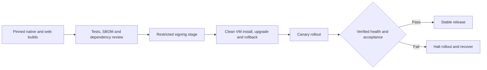
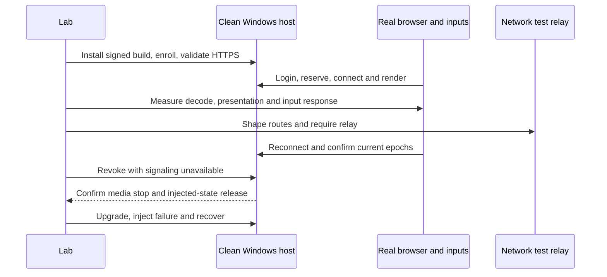

# Operations, delivery and end-to-end acceptance

## Packaging and deployment

The release pipeline signs Electron, static assets as packaged, the unprivileged control process, native worker/helper and optional broker, then verifies the installer and payload on a clean Windows VM. Package matching native ABI/runtime versions and an SBOM. Pin toolchains and dependencies, review redistribution rights per component, and keep signing keys out of ordinary build jobs. The host installer does not provision a relay or install an optional virtual display/input driver without an explicit, independent deployment decision.

Use a staged update: download and validate allowed publisher/signature and version policy, stop admitting sessions, drain/revoke active sessions, snapshot durable config and secret references, install consistent payloads, run migration under single owner, and confirm health before committing activation. On failure use authenticated recovery package and documented compatible backup. Do not roll back a security-denied version. Preserve data unless explicit uninstall policy requests removal. Keep secrets protected rather than exporting them with diagnostic bundles.

## Signals and runbooks

| Signal | Where it comes from | Operator uses it to |
|---|---|---|
| Login and reservation outcomes | Control admission, keyed by bounded reason | Distinguish bad credentials, forbidden source, occupied slot and unavailable host |
| Session stages and deadline counters | Session actor with safe correlation ID | Localize startup, SDP, ICE, first frame and teardown failures |
| Capture/encode FPS, queue age, GPU provider | Worker | Identify capture starvation, copying, encode saturation or device loss |
| Presented FPS, codec, route, RTT/loss | Browser and selected peer stats | Distinguish decode/presentation limits, loss and relay; unavailable stays unavailable |
| Release/disarm outcomes | Input helper | Verify lease safety without logging actual key contents |
| Child readiness and crash budget | Supervisor/broker | Explain locked desktop/no login, startup failure and crash loop |
| Cert expiry, relay auth and allocation quota | Control and relay | Renew certs, detect owner-side config failure and plan relay capacity |

Use structured redacted logs with bounded disk use and stable component/reason values. Do not persist frames, keystrokes, session secrets, full SDP, IP-containing raw candidates or TURN credentials. Restrict diagnostics behind admin and safe local export. Keep independent liveness for control and per-component readiness; public liveness must not expose host configuration.

For no frames, verify first HTTPS/WSS, then selected ICE route, then capture, encoder, receiver decode and presentation; identify the failing stage before changing network policy. For stale/stuck input, invoke local stop, verify disarm, and confirm helper shutdown/expiry. For cert/relay faults, repair the affected endpoint separately; never downgrade TLS or remove authorization controls. Back up configuration/policy with restricted storage and test recovery on a matching version.

## Integration gates and ownership

| Gate | Required evidence |
|---|---|
| Contracts | Shared generated-schema fixtures, frame limits, valid permutations, malformed-input rejection, timeout and compatibility cases |
| Local LAN flow | Clean enrollment, browser HTTPS/WSS, source/preset/effective settings, first presented frame, controller/view-only, sound, Stop Sharing and leak-free disconnect |
| Authorization | No unauthenticated capture/input; deny stale epoch, cross-session, replay, scope change and revoked users; media revoke works independently of WSS |
| Windows lifecycle | Locked/headless/RDP/user-switch coverage on supported configurations; GPU reset, partial init, hotplug and process crash cleanup |
| Network | Direct and forced relayed peer traffic; NAT and denied UDP, cert expiry, WSS reconnect, ICE restart and route metrics |
| Installer | Verify signature, upgrades, config backup/restore, rollback, uninstall and no stranded services |
| Performance | Record physical response latency, presented FPS and resource trends with OS/GPU/driver/browser/route, baseline and reproducible workload |

Use a fixed reference source and a physical input event with a visible device marker or timestamp, then capture the resulting displayed response on the **browser device** via a high-speed camera or equivalent measured setup. Compute the p95 on repeated paired observations; record frame quantization, startup vs steady state, workload, warm-up, route/network shaping, codec, display refresh, actual FPS and host/client resource data. Do not use RTC RTT, submit timestamps or encode latency alone as input-to-photon. Compare Electron and native at matching settings and test audio sync and 8-hour resource soak. The [architecture targets](../01-product-and-architecture.md) apply to certified conditions only; keep experimental profiles labeled until measured. Publish model/driver/test matrix, evidence and known limits alongside any release.

Follow the [delivery roadmap](../06-delivery-and-validation.md). Start with contract fixtures and one LAN vertical slice, then make the native performance decision from data before increasing supported hardware, remote topologies, or input providers.
