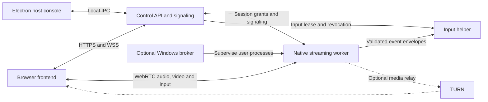

# System and component designs

This is the implementation design for the Windows desktop streaming product. Start with the system design and contracts, then use each component's build and test sections during implementation. The designs apply to both repositories and describe intended behavior. No application, installer, performance result, or production deployment is implied.

| Design | Covers |
|---|---|
| [01 · End-to-end system](01-system.md) | Architecture, installation through disconnect, recovery, deployment profiles and release gates |
| [02 · Browser frontend](02-browser.md) | Routes, UI states, WebRTC receiver, input capture and client telemetry |
| [03 · Electron host console](03-host-console.md) | Installation, bootstrap, supervised processes, publishing a URL and local stop |
| [04 · Control API and signaling](04-control-and-signaling.md) | Authorization, persistence, REST, signaling, session concurrency and revocation |
| [05 · Native streaming worker](05-streaming-worker.md) | Capture, GPU encoding, audio, WebRTC sender and pipeline recovery |
| [06 · Input helper](06-input-helper.md) | Input wire format, coordinate mapping, exclusive lease and watchdog |
| [07 · Windows session broker](07-session-broker.md) | Optional Session 0 service, interactive process lifecycle and privilege boundaries |
| [08 · STUN and TURN](08-network-and-relay.md) | ICE policy, relay provisioning, credentials, validation and capacity |
| [09 · Shared contracts](09-contracts.md) | IDs, message schemas, IPC framing, versioning and timing |
| [10 · Operations and acceptance](10-operations-and-acceptance.md) | Installer, upgrades, telemetry, rollback and integration/performance validation |

The existing [requirements](../01-product-and-architecture.md), [session protocol](../03-session-protocol.md), and [delivery roadmap](../06-delivery-and-validation.md) establish product scope. This set refines their proposed behavior into implementable contracts; definitions here govern new implementation where older examples are less specific. Defaults and budgets remain provisional until measured. The [research register](../07-research-and-decisions.md) records supporting sources.

